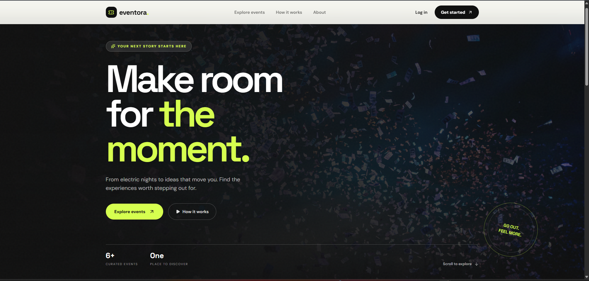
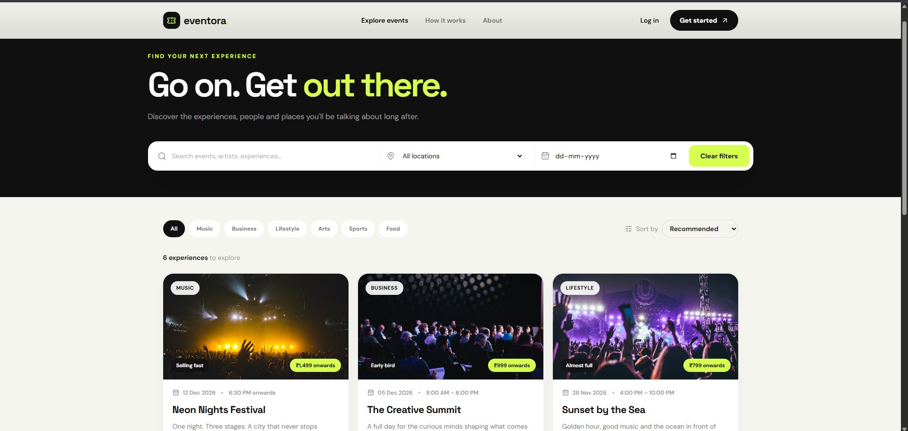
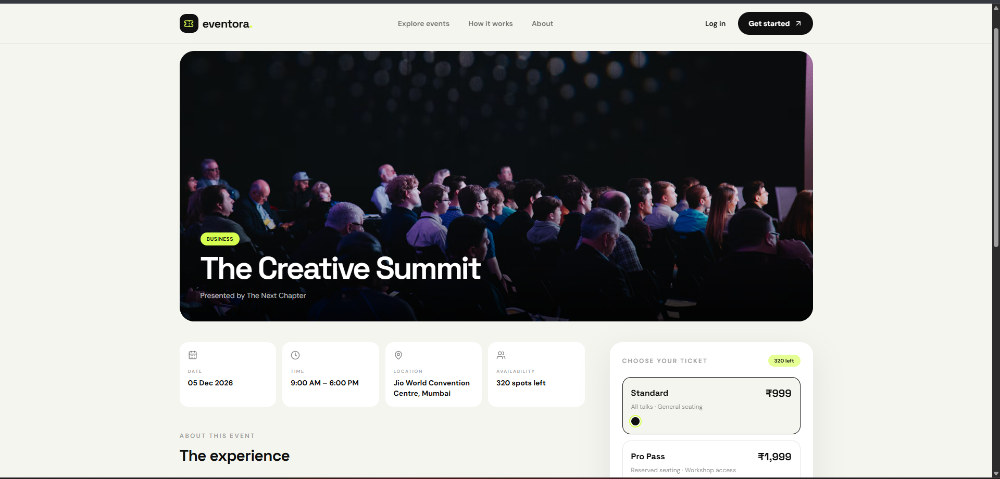
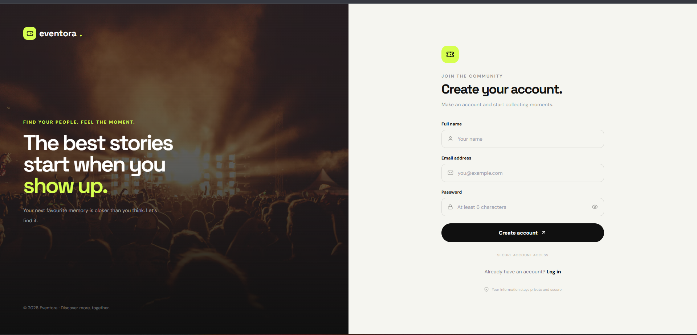
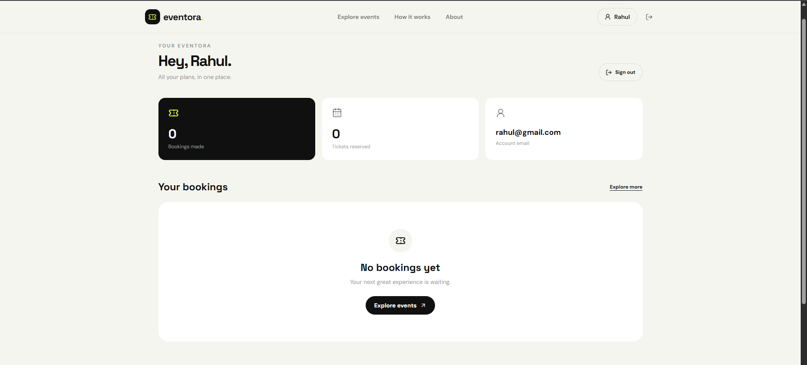
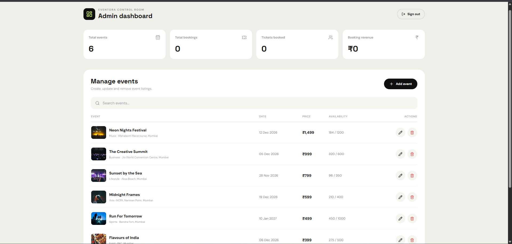
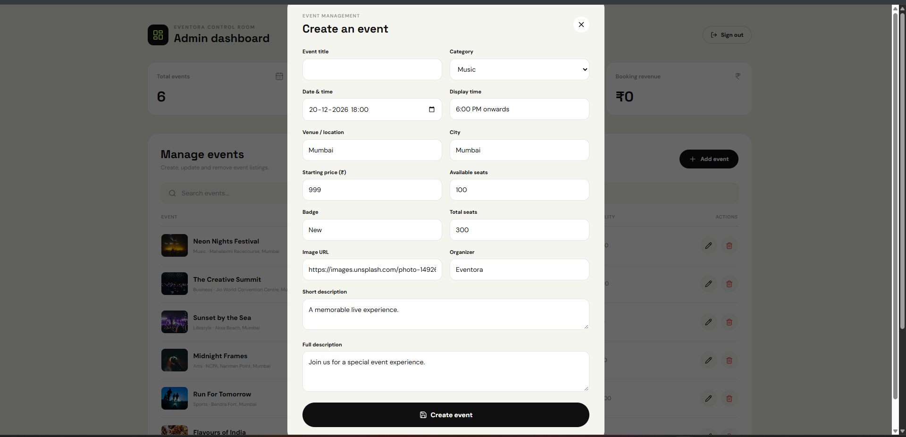

# Eventora – Event Booking Platform

Eventora is a full-stack event booking platform that allows users to explore upcoming events, view event details, select tickets, and book their seats online. It also provides an admin dashboard for managing events and monitoring bookings.

The application is built using **React.js, Tailwind CSS, Node.js, Express.js, and MySQL**, with JWT-based authentication and a responsive user interface.

## 🌐 Live Demo

- **Frontend:** https://event-booking-sigma-ashen.vercel.app
- **Backend API:** https://event-booking-87rc.onrender.com

## 📸 Screenshots

### 🏠 Home Page


### 🔍 Explore Events


### 🎫 Event Details


### 📝 Signup Page


### 👤 User Account


### ⚙️ Admin Dashboard


### ➕ Create Event


## ✨ Features

### 👤 User Features

- User registration and login.
- JWT-based authentication.
- Browse and explore available events.
- View detailed event information.
- Search and filter events.
- View event dates, locations, descriptions, and ticket prices.
- Select ticket types and quantities.
- Book event tickets.
- View personal booking history.
- Access booking information through the account dashboard.
- Logout functionality.

### 🔐 Admin Features

- Admin dashboard.
- Create new events.
- Update existing event details.
- Delete events.
- Manage event categories and descriptions.
- Configure ticket types and prices.
- Manage event inclusions.
- Set total and available seats.
- View all user bookings.

### 🎟️ Booking Features

- Secure booking process.
- Ticket type selection.
- Quantity validation.
- Seat availability validation.
- Server-side booking management.
- Booking history linked to user accounts.
- Database-backed booking records.

### 🎨 UI Features

- Responsive design.
- Modern interface built with Tailwind CSS.
- Interactive event cards.
- Event detail pages.
- Loading indicators for important actions.
- Smooth navigation using React Router.
- Lucide icons.

## 🛠️ Tech Stack

### Frontend

- React.js
- Vite
- Tailwind CSS
- React Router DOM
- Lucide React
- JavaScript
- HTML5
- CSS3

### Backend

- Node.js
- Express.js
- REST API
- JSON Web Token (JWT)
- bcrypt
- MySQL2

### Database

- TiDB Cloud Starter (MySQL-compatible database)
- MySQL

### Deployment

- Frontend: Vercel
- Backend: Render
- Database: TiDB Cloud

### Development Tools

- Git and GitHub
- VS Code
- Postman
- npm

## 📂 Project Structure

```text
EventBooking/
│
├── frontend/
│   ├── public/
│   ├── src/
│   │   ├── assets/
│   │   ├── components/
│   │   ├── pages/
│   │   ├── data/
│   │   ├── utils/
│   │   ├── App.jsx
│   │   └── main.jsx
│   │
│   ├── .env
│   ├── package.json
│   └── vite.config.js
│
├── backend/
│   ├── src/
│   │   ├── config/
│   │   ├── middleware/
│   │   ├── routes/
│   │   └── db.js
│   │
│   ├── data/
│   ├── .env
│   ├── package.json
│   └── server.js
│
└── README.md
```

*Note: The structure above represents the logical organization of the application. Adjust folder names if your repository uses a different structure.*

## ⚙️ Installation and Setup

Follow these steps to run Eventora locally.

### 1. Clone the Repository

```bash
git clone <YOUR_GITHUB_REPOSITORY_URL>
cd EventBooking
```

### 2. Frontend Setup

Navigate to the frontend directory:

```bash
cd frontend
```

Install dependencies:

```bash
npm install
```

Create a `.env` file in the frontend directory:

```env
VITE_API_URL=http://localhost:5000
```

Start the development server:

```bash
npm run dev
```

The frontend will typically run at:

```text
http://localhost:5173
```

### 3. Backend Setup

Open another terminal and navigate to the backend directory:

```bash
cd backend
```

Install dependencies:

```bash
npm install
```

Create a `.env` file in the backend directory:

```env

PORT=5000
CLIENT_ORIGIN=http://localhost:5173

DB_HOST=localhost
DB_PORT=3306
DB_USER=root
DB_PASSWORD=change_me
DB_NAME=eventora

JWT_SECRET=replace_with_a_long_random_secret
JWT_EXPIRES_IN=1d
ADMIN_NAME=Eventora Admin
ADMIN_EMAIL=admin@eventora.demo
ADMIN_PASSWORD=change_admin_password

```

Configure the database credentials according to your MySQL or TiDB Cloud database.

Start the backend server:

```bash
npm start
```

If your project uses a development script, you can also run:

```bash
npm run dev
```

The backend will run at:

```text
http://localhost:5000
```

## 🔑 Environment Variables

### Frontend Environment Variables

| Variable | Description |
|---|---|
| `VITE_API_URL` | Backend API base URL |

Example:

```env
VITE_API_URL=http://localhost:5000
```

For production:

```env
VITE_API_URL=https://event-booking-87rc.onrender.com
```

### Backend Environment Variables

| Variable | Description |
|---|---|
| `PORT` | Backend server port |
| `NODE_ENV` | Application environment |
| `DB_HOST` | Database host |
| `DB_PORT` | Database port |
| `DB_USER` | Database username |
| `DB_PASSWORD` | Database password |
| `DB_NAME` | Database name |
| `JWT_SECRET` | Secret key used for JWT authentication |

**Important:** Never commit `.env` files or expose database credentials and JWT secrets in a public repository.

## 🗄️ Database Design

Eventora uses a MySQL-compatible relational database to store application data.

The main database tables include:

| Table | Purpose |
|---|---|
| `users` | Stores user account and authentication information |
| `events` | Stores event details, dates, prices, and seat availability |
| `event_tickets` | Stores ticket types and their prices |
| `event_includes` | Stores items and experiences included with events |
| `bookings` | Stores user booking and ticket information |

### Database Relationships

- A user can create multiple bookings.
- An event can have multiple ticket types.
- An event can have multiple inclusions.
- Each booking is associated with a user and an event.
- Event seat availability is updated through the booking process.

## 🔗 API Endpoints

The backend exposes REST API endpoints for authentication, event management, and bookings.

### Authentication

| Method | Endpoint | Description |
|---|---|---|
| POST | `/auth/signup` | Register a new user |
| POST | `/auth/login` | Authenticate a user |

### Events

| Method | Endpoint | Description |
|---|---|---|
| GET | `/events` | Get all events |
| GET | `/events/:id` | Get event details |
| POST | `/events` | Create an event (Admin) |
| PUT | `/events/:id` | Update an event (Admin) |
| DELETE | `/events/:id` | Delete an event (Admin) |

### Bookings

| Method | Endpoint | Description |
|---|---|---|
| POST | `/bookings` | Create a booking |
| GET | `/bookings/mine` | Get logged-in user's bookings |
| GET | `/bookings/admin/all` | Get all bookings (Admin) |

**Note:** Protected endpoints require a valid JWT access token in the request header.

```http
Authorization: Bearer YOUR_JWT_TOKEN
```

## 🔒 Authentication and Security

Eventora implements authentication and authorization to protect user and administrative operations.

- Passwords are hashed using bcrypt.
- JWT is used for authentication.
- Protected API routes verify the user's token.
- Role-based authorization restricts administrative operations.
- Booking operations are validated on the backend.
- Seat availability is checked before confirming a booking.
- Database operations are used to maintain booking consistency.

## 🚀 Deployment

Eventora is deployed using Vercel, Render, and TiDB Cloud.

### Frontend Deployment – Vercel

1. Push the frontend code to GitHub.
2. Import the repository into Vercel.
3. Configure the frontend root directory.
4. Add the production environment variable:

```env
VITE_API_URL=https://event-booking-87rc.onrender.com
```

5. Deploy the application.

**Production URL:**

https://event-booking-sigma-ashen.vercel.app/

### Backend Deployment – Render

1. Connect the GitHub repository to Render.
2. Configure the backend root directory.
3. Set the build command:

```bash
npm install
```

4. Set the start command:

```bash
npm start
```

5. Configure the required environment variables.
6. Deploy the backend service.

**Backend URL:**

https://event-booking-87rc.onrender.com

### Database Deployment – TiDB Cloud

1. Create a TiDB Cloud Starter cluster.
2. Configure the database and required tables.
3. Obtain the database connection credentials.
4. Add the database credentials to Render environment variables.
5. Configure the MySQL connection with TLS enabled.

### CORS Configuration

The backend must allow requests from the deployed frontend domain.

Example:

```javascript
import cors from "cors";

const allowedOrigins = [
  "http://localhost:5173",
  "https://event-booking-sigma-ashen.vercel.app",
];

app.use(
  cors({
    origin: allowedOrigins,
    methods: ["GET", "POST", "PUT", "DELETE", "OPTIONS"],
    allowedHeaders: ["Content-Type", "Authorization"],
  })
);
```

Ensure CORS middleware is registered before API routes.

## 🧪 Testing

You can test the backend API using Postman or a browser.

**Get all events:**

```http
GET https://event-booking-87rc.onrender.com/events
```

**Get event details:**

```http
GET https://event-booking-87rc.onrender.com/events/1
```

For protected endpoints, include the JWT token in the Authorization header.

## 📌 Future Enhancements

- Online payment gateway integration.
- Email confirmation after successful booking.
- Downloadable event tickets with QR codes.
- Booking cancellation functionality.
- Advanced event filtering and sorting.
- Event reviews and ratings.
- Improved admin analytics dashboard.
- Automated booking notifications.

## 👨‍💻 Author

**Rahul Patel**

Computer Engineering Graduate | Full Stack Developer

- GitHub: https://github.com/appy-spec
- Portfolio: https://portfolio-psi-one-mzgyj2data.vercel.app/#main

## 📄 License

This project is developed for learning and demonstration purposes. You may use it as a reference for educational and personal projects.

---

⭐ If you find this project useful, consider giving it a star on GitHub!
